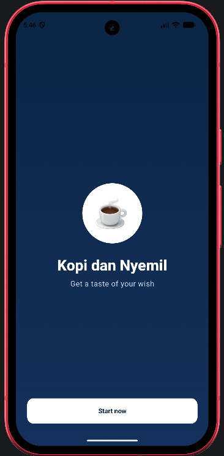
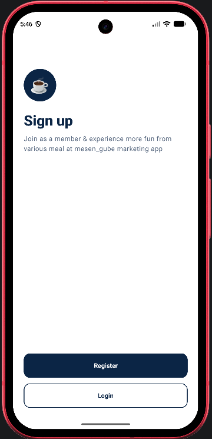
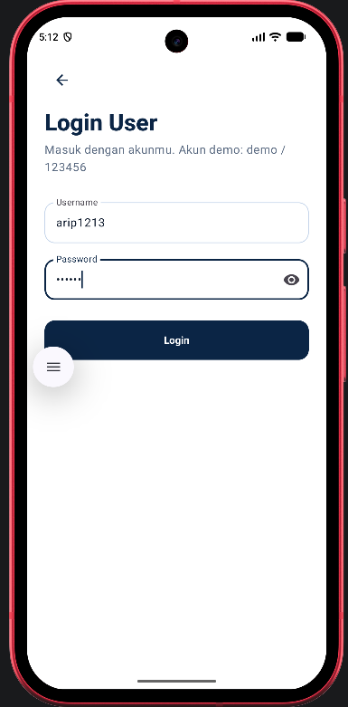
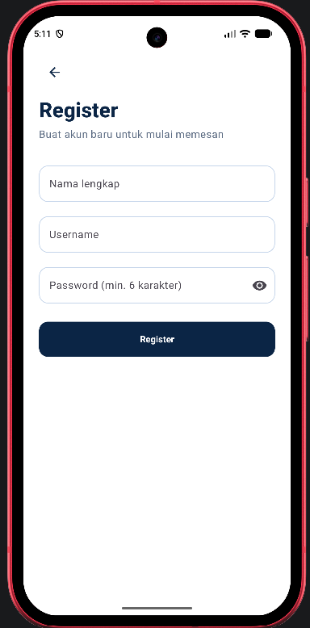
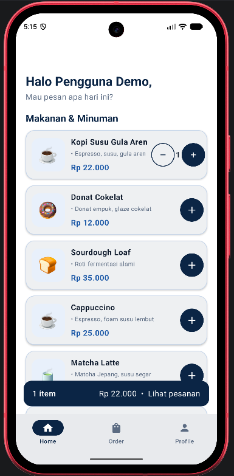
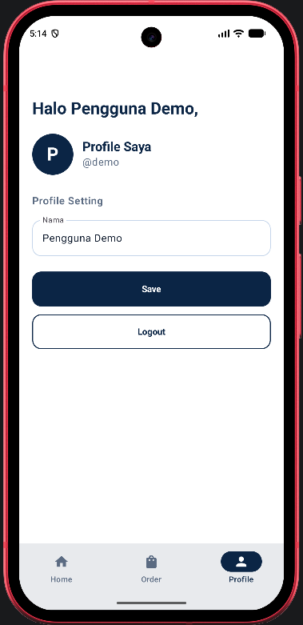
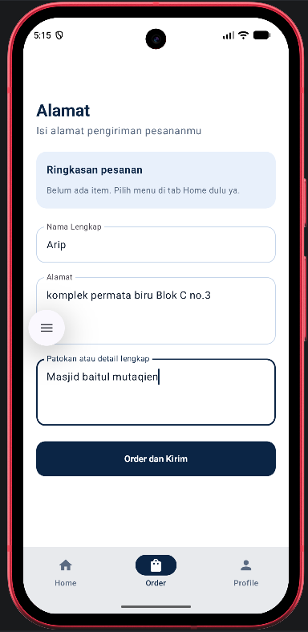
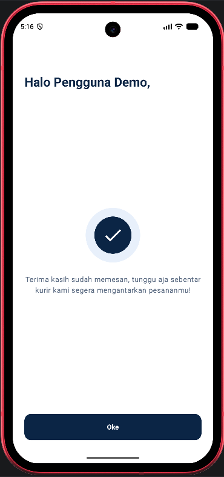

# Kopi dan Nyemil

Aplikasi Android pemesanan makanan & minuman Kopi dan Nyemil ("Get a taste of your wish").
Dibuat untuk tugas mata kuliah Pengembangan Aplikasi Mobile menggunakan Kotlin dan Jetpack Compose
dengan tema warna biru tua dan putih.

## Deskripsi

Pengguna dapat mendaftar atau login, melihat daftar menu makanan dan minuman, memilih pesanan,
mengisi alamat pengiriman, lalu menerima konfirmasi pesanan. Aplikasi ini tidak memakai database;
seluruh data menggunakan data statis (dummy) dan disimpan di memori selama aplikasi berjalan.

##  Fitur

1. **Splash / Welcome**: menampilkan logo, nama aplikasi, tagline, dan tombol Start now.
2. **Sign Up**: halaman pilihan untuk Register atau Login.
3. **Login User**: form username dan password dengan validasi. Tersedia akun demo untuk mencoba aplikasi.
4. **Register**: form nama lengkap, username, dan password. Username tidak boleh sama dengan akun lain dan password minimal 6 karakter.
5. **Home**: menampilkan sapaan nama pengguna dan daftar 7 menu makanan dan minuman lengkap dengan deskripsi dan harga. Pengguna bisa menambah atau mengurangi jumlah pesanan, dan bar keranjang menampilkan total item dan total harga.
6. **Profile**: pengguna dapat mengubah nama lalu menyimpannya dengan tombol Save, serta keluar dari akun lewat tombol Logout.
7. **Alamat Pengiriman (Order)**: menampilkan ringkasan pesanan dan form nama lengkap, alamat, serta patokan atau detail lengkap. Pesanan dikirim lewat tombol Order dan Kirim.
8. **Konfirmasi Pesanan**: menampilkan pesan terima kasih dan tombol Oke untuk kembali ke Home.

##  Teknologi

- Bahasa: Kotlin
- UI: Jetpack Compose + Material 3
- Navigasi: Navigation Compose
- State: ViewModel + Compose State
- Build: Gradle Kotlin DSL (AGP 8.5.2, Kotlin 1.9.24)
- Min SDK 24, Target SDK 34

##  Cara Menjalankan

1. Clone repository:
   ```bash
   git clone https://github.com/Aripm33/KopiDanNyemil.git
   ```
2. Buka folder proyek di Android Studio (File > Open), lalu tunggu **Gradle Sync** selesai.
3. Jalankan emulator atau sambungkan HP Android (USB debugging aktif).
4. Klik tombol Run ▶

**Akun demo:** username `demo`, password `123456`
(atau buat akun baru lewat menu Register).


## Alur Aplikasi

`Splash → Sign Up → (Login | Register) → Home ⇄ Order ⇄ Profile → Konfirmasi Pesanan → Home`

## Screenshot

### Splash, Sign Up, Login, dan Register






### Home, Profile, Alamat, dan Konfirmasi






## Pembuat

- Nama: Arip Munandar
- NIM : 1247050094
- Mata Kuliah: Pengembangan Aplikasi Mobile

